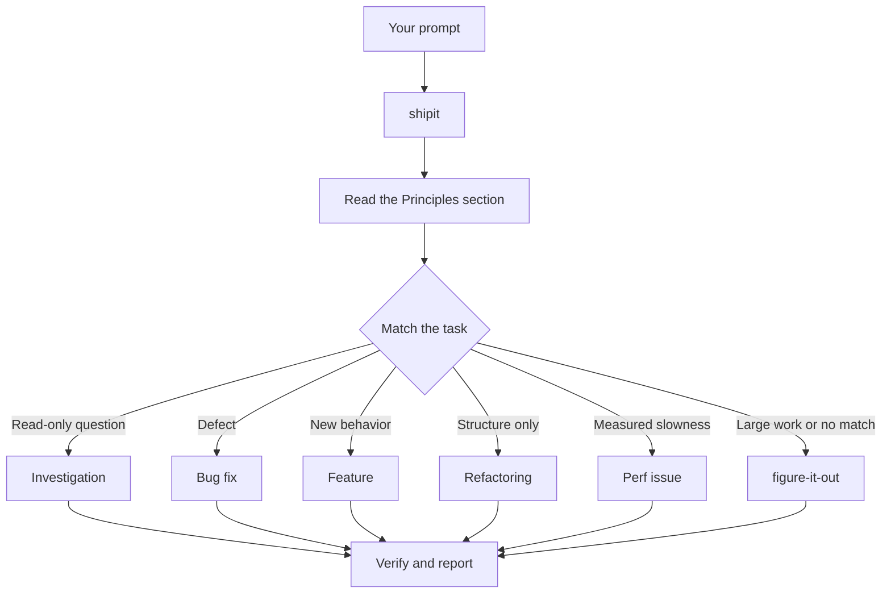

# Route work through `/shipit`

`/shipit` is the front door. You give it a goal, it matches one of twenty-two playbooks, copies that playbook's steps into the todo list, and calls the other skills as the steps need them. In this page you learn what a good prompt looks like, and how little of one you actually need.

## What happens to your prompt



The diagram shows the common routes. shipit adds three playbooks pstack doesn't have. **Ideation** answers an idea or a "what if" with scored options in an artifact and stops for your pick. **Research** compares how other tools do something, with a scored matrix and sources. **Design audit** iterates UI in rounds of light and dark screenshots until it scores 8/10. There are also playbooks for hillclimbing a metric, diagnosing runtime symptoms and captured traces, prototypes, visual parity, authoring and evaluating skills, autonomous runs, babysitting a PR or stack to merge-ready, shipping a verified stack, session pickup, pausing safely, and worktree cleanup. The [playbook directory](../../skills/shipit/playbooks/) has the full set.

## Say the goal, not the ceremony

You don't write a spec. You say what's wrong or what you want, plus anything you already know that saves the agent time:

```text
/shipit users get two notifications after a retry. repro first, then fix and verify.
```

That's a Bug fix prompt. "repro first" is a real constraint, not politeness, and the playbook honors it. Watch the todo list fill with the Bug fix steps. A skipped step stays visible with `skip: <reason>`.

## What goes in a prompt

A useful prompt carries up to five things, and each one fits in a sentence:

- **The goal.** Say what's wrong, or what you want.
- **The done check.** It must be able to pass or fail. "Make it better" and "work on it for an hour" aren't checks.
- **The proof you want to see.** Ask for the real command output, screenshots of the flow, the stored value, or a before-and-after number.
- **What you already know.** A symptom, a repro step, a log line, or a link saves the agent a search.
- **The real constraints.** "repro first", "don't change any code yet", "zero behavior change", and "let me review before proceeding" each change what the agent does.

Here's one prompt with all five:

```text
/shipit the csv export drops its last row since yesterday's deploy. failing job id is 4812. repro first, then fix. done means the 60k-row fixture exports every row. show me the row counts before and after.
```

Two things are worth leaving out:

- **The how.** Say what to achieve, and leave the agent room to find a better path than the one you'd pick. The same goes for a list of skills, covered in the pitfall below.
- **Your theory of the cause, at first.** A stated guess narrows the search to wherever you pointed. Let the agent restate the problem before you share your hunch.

For a noisy report, such as a long thread or a vague bug, make the restatement the first step:

```text
/shipit read this thread. restate the underlying issue in your own words, in plain english. don't change any code yet.
```

A misreading shows up in the restatement, before any code exists. Correct it there, and it costs you one message instead of one wrong fix. [`/in-your-own-words`](../../skills/in-your-own-words/SKILL.md) does the same playback on demand. [`/sharpen`](../../skills/sharpen/SKILL.md) goes the other way and reframes your task the way a top expert would approach it, without deciding your choices for you.

## Follow up short

When the conversation already carries the context, the prompt shrinks to almost nothing. All of these are enough:

```text
/shipit do it
```

```text
continue
```

```text
keep going until done
```

Short works because the playbook holds the structure. If you told the session to stay in shipit mode, as [Set up shipit](./01-setup.md#run-your-first-task) shows, the skill keeps applying on every turn. Your words carry the intent, and the skill carries the rigor.

## Switch tasks with "new task"

A long chat accumulates context from the last task. When you change subjects, say so:

```text
/shipit new task. figure out why the cache entry survives logout. don't change any code yet.
```

"new task" tells `/shipit` to re-match rather than continue the prior playbook. "don't change any code yet" pins this one to Investigation. Without those two phrases, a session mid-Feature tends to treat your question as the next feature step.

## Give parallel work its own worktree

If you run several agents against one checkout, they fight over the working tree, the ports, and the build output. Each agent needs its own.

On a berth box, that's a berth task. `berthd task new acme/parser-port --agent claude --prompt "…"` makes a worktree with its own branch, port, and environment, starts an agent in it, and sends a `<berth-notification>` back to your session when the agent finishes or needs you. Ask the parent session to hand work out this way, or let a playbook do it. [`/arena`](../../skills/arena/SKILL.md) already runs one berth task per attempt when berth is available. The **berth-orchestrate** skill covers the rest: prompting a running agent, waiting on its turn, running a check in its worktree.

Without berth, ask for a worktree up front:

```text
/shipit new task. branch off <base> in a fresh worktree, then port the parser change there.
```

Subagents that shipit spawns for parallel attempts get `isolation: "worktree"`, so each one writes to its own checkout. Worktrees cost disk and machine resources, so one laptop runs only a handful at once. A box runs more. The [Opening a PR playbook](../../skills/shipit/playbooks/opening-a-pr.md) already works from a worktree for code changes, so mostly you only say this when a specific base or location matters.

Worktrees accumulate. When disk gets tight, ask:

```text
/shipit what's eating my disk? prune the worktrees that are safe to prune.
```

The [Worktree cleanup playbook](../../skills/shipit/playbooks/worktree-cleanup.md) classifies every worktree by merge state, uncommitted work, and which sessions still touch it. It deletes only what that evidence clears and pauses for your call on anything holding uncommitted work.

## Leave it running

When you step away, say what done means and go:

```text
/shipit im stepping away. keep going until the migration check reports zero old callers. log your decisions.
```

Work you'll review later routes through [`/figure-it-out`](../../skills/figure-it-out/SKILL.md), which designs the run's phases and keeps a [`/show-me-your-work`](../../skills/show-me-your-work/SKILL.md) decision log. [Run work while you sleep](./07-overnight.md) covers the full overnight contract, including auto mode and `/loop`.

**Pitfall:** don't enumerate skills in your prompt ("use /how, then /architect, then /arena..."). The playbook already sequences them, and a hand-written sequence usually reorders or drops steps the playbook would have kept. Name a skill only when you want to override a specific choice.

Read [`shipit`](../../skills/shipit/SKILL.md) itself for the full routing rules.

Next: [Understand the code](./03-understand.md).
