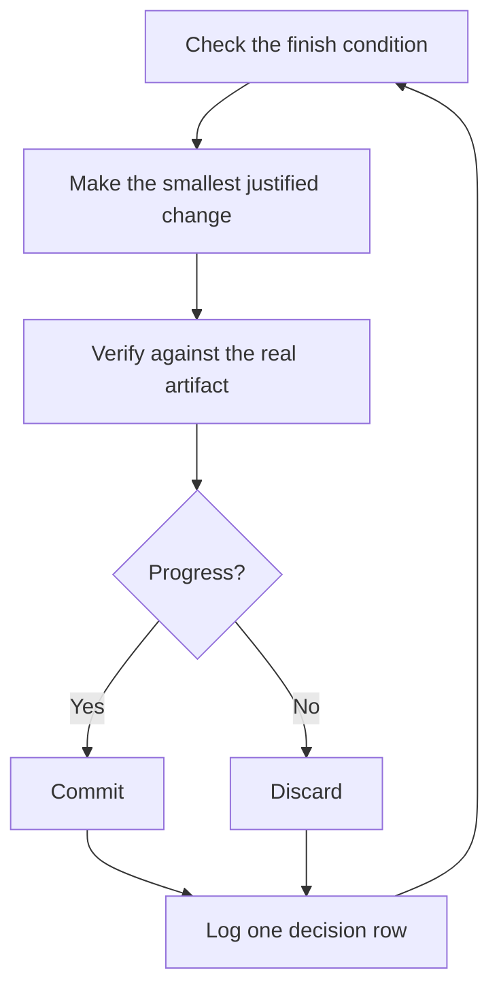

# Run work while you sleep

This is the payoff for everything before it. An agent you can trust to verify its own work is an agent you can leave alone with a hard task. What makes that safe isn't hope. It's a checkable finish condition, an isolated worktree or berth task, permissions that won't stall the run, and a decision log you audit in the morning.

## Earn the trust before the loop

A loop you don't trust just produces unchecked work faster, and the mess compounds with every iteration. Before you leave one running, check that it has earned it:

- You've done the task once by hand, or watched an agent do it, so you know what good looks like.
- The agent has the tools and signals you'd use yourself: the verification skill, the profiler, the logs.
- Every stage proves its work and can stop the line when the work misses the bar.
- You've read a few transcripts and turned the repeated failures into tools, skills, or checks.

Make the loop autonomous only after all four hold. Until then, run it while you watch.

## Set permissions before you leave

Run an unattended session in auto mode, or with a permission allowlist that covers the commands its checks run. Under default permissions, the first unexpected prompt stops the run, and it waits there until morning. Auto mode keeps routine actions moving and still pauses on the irreversible ones: force-pushing a shared branch, deploying, deleting data, messaging customers, publishing. Those wait for you whatever the mode, which is what you want.

## The overnight contract

A good handoff has the goal, the finish condition, permissions, and an escape hatch. It doesn't need to be long:

```text
/shipit im going to bed. migrate every caller to the new parser in a fresh worktree off <base>.
done means zero old callers, all parser fixtures pass, old api deleted.
keep a decision log. don't ask me before committing.
loop until done. if you're truly stuck after a few hours, stop and write up why.
```

Walk through what each line buys you:

- "im going to bed" is a session override. The agent stops asking and keeps going.
- "done means..." turns the goal into checks every iteration can run.
- "fresh worktree off `<base>`" keeps the run from colliding with anything else you have open. On a berth box, the run can live in its own berth task instead, so it keeps going on the box after your laptop closes.
- "don't ask me before committing" pre-answers the permission the agent would otherwise block on.
- "loop until done" hands the wake-up to Claude Code's `/loop`, a built-in, not a shipit skill. The [Autonomous run playbook](../../skills/shipit/playbooks/autonomous-run.md) uses it to re-check the finish condition, self-paced or on an interval. An event to wait for (CI, a merge, a berth task finishing) wakes the run through a background task or a `<berth-notification>`, so nothing polls in a sleep loop. You can also start the loop yourself, as `/loop /shipit <the contract>`.
- The escape hatch lets it stop at a genuine dead end and write up why, which beats eight hours of creative goal reinterpretation.

Because you'll review this work after stepping away, `/shipit` routes it through [`/figure-it-out`](../../skills/figure-it-out/SKILL.md), which designs the run's phases before any code and wires in the decision log.

To stop a run on purpose, tell the agent to pause, or that you're about to go offline, restart Claude Code, or run out of context. The [Pause safely playbook](../../skills/shipit/playbooks/pause-safely.md) finishes or backs out of the current step, commits a work-in-progress checkpoint, and writes a resume note. A fresh session picks the work up from that note through the Session pickup playbook. Saying "keep going" never triggers a pause.

## What the loop does all night



One change, one check, one log row, every iteration. Changes that didn't help get discarded, not left to ride. A plateau means pivot, not stop, and the finish condition never quietly relaxes to declare victory.

## The morning audit

[`/show-me-your-work`](../../skills/show-me-your-work/SKILL.md) is what makes the run reviewable. Each row records the time, phase, decision, reason, an evidence pointer, and the result, in a TSV at `decisions.tsv` (or `.audit/<task-slug>.tsv` when several runs share a directory). It stays local by default. Commit it when the work is ambitious enough that a reviewer needs the trail to trust the result. Inside berth, the log can be registered as a table artifact, so you open it in Shipyard as a table instead of reading tab-separated text.

When you're back, ask for the run in review form:

```text
/show-me-your-work catch me up on what you did last night
```

Before the skill hands back its summary, it spawns a reviewer on a different model family to read the trail and the transcript, and the reply ends with an Attention section listing what deserves your scrutiny. Read that section first, then the log rows it points at. You're auditing decisions, not re-reading the whole night.

## When the night holds a queue, not a task

The contract above drives one task to one finish condition. Some nights hold more, a queue of independent changes. Do them one at a time. Each goes through Feature or Bug fix and then Opening a PR, so each lands as its own PR off trunk with its own proof:

```text
/shipit these five changes are independent. do them one at a time, open a PR for each, and keep a decision log. i'll review in the morning.
```

For a program too big for one session, such as a migration that spans many PRs or days, the **figure-it-out** skill designs the run first. It sets the finish condition, what fans out, and how each piece is verified.

## Run many tasks in parallel on a box

A berth box is where this scales. Give each body of work its own session on the box, and hand each piece to a berth task through the **berth-orchestrate** skill. Every task gets its own worktree, port, and environment. The box keeps running when your laptop is closed, and Shipyard shows you every agent, its status, and the ones waiting on you. Start your prompts with `/shipit`, and the agents it hands work to follow the playbooks.

A few habits help:

- Give each body of work its own session, such as a feature, a migration, a perf push, or a tech-debt cleanup. Several can run side by side on one box.
- Point the session at related sessions, finished ones included, with `/recall`. They become context for the work.
- Give each PR a verification pass before it merges.
- Ask for a plan backed by data, and have it answer open questions with prototypes before it asks you. Inside berth, the plan to approve and the progress of the queue show up as artifacts rewritten as work lands.

One prompt can carry a whole program, from research through execution:

```text
/shipit refactor this repo so its architecture is more agent friendly. use /correct and /architect on past commits and review comments to find the mistakes agents make most here. use /recall for context from past sessions. answer open questions with prototypes instead of asking me. come back with a plan backed by real data. once i approve it, run it with /figure-it-out.
```

Without a box, the same work runs on your laptop with subagents in worktrees. It stops when the laptop sleeps, and a laptop runs only a handful of worktrees at once.

## Let loops start themselves

Every loop above still waits for you to start it. A scheduled or event-driven trigger removes that step. Software maintenance splits into stages that suit this well: triage a report, reproduce it, fix it, verify the fix. Two rules keep such a line trustworthy:

- Every stage can stop the line. Triage can decide the report is expected behavior, repro can fail to reproduce it, and the fixer can judge the change too risky. Each of those outcomes is useful, because it keeps bad work from reaching the next stage, where it costs more to undo.
- Every stage hands over evidence. Repro attaches screenshots of the broken state, and the fix attaches before-and-after proof. A human can then check that the agent fixed the right thing before reading a line of code.

Two triggers fit. Claude Code's `/schedule` runs an agent on a cron schedule, which suits a nightly triage pass or a daily `/maintain-verification-skill`. On berth, the **berth-hooks** skill runs a command when something happens, such as an agent finishing (`agent.finished`) or a worktree being created, so one stage finishing can start the next. Hooks run as you, automatically, so add them deliberately and test them with `berthd emit` before you rely on them.

**Pitfall:** a duration is not a finish condition. "work on this for 4 hours" gives the agent nothing to check, and you'll wake up to four hours of motion instead of a result. Give `/loop` a predicate that can pass or fail.

Next: [Steer with principle names](./08-principles.md).
